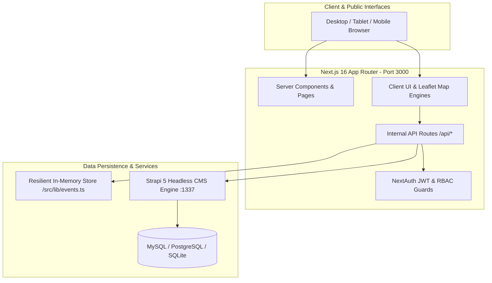

# EventDiscovery Pakistan — Quality Assurance Strategy

## 1. Executive Summary & Quality Vision
EventDiscovery Pakistan is a web-based community event discovery and engagement platform built with **Next.js 16 (App Router)**, **React 19**, **Leaflet.js 1.9 Geo-Maps**, **NextAuth.js v5**, and **Strapi 5 Headless CMS**.

The objective of this QA Strategy is to establish a rigorous, repeatable, and automated quality assurance lifecycle covering:
- **Resilient Dual-Mode Operation**: Seamless operation across both connected CMS (Strapi 5 + SQL) and standalone in-memory mode (`/src/lib/events.ts`).
- **Zero Critical / High Security Vulnerabilities**: Strict server-side RBAC on administrative APIs, input validation via Zod schemas, sanitization of user submissions, and zero exposure of credentials/passwords.
- **Robust Functional User Journeys**: End-to-end verification of public browsing, event discovery via Leaflet maps, ticket pass reservation (RSVP) with QR pass wallet, community review submissions, and event proposal/moderation workflows.
- **Cross-Platform & Responsive Stability**: Flawless UI rendering across Desktop, Tablet, and Mobile viewport breakpoints.

---

## 2. Scope & Target Architecture



### In-Scope Modules:
1. **Public Discovery Hub**: Homepage (`/`), Events Directory (`/events`), Categories (`/categories`), Event Details (`/events/[slug]`), and 404 handler (`/_not-found`).
2. **Interactive Geo-Map Engine**: Leaflet 1.9 map synchronization, marker filtering by Pakistani cities (*Lahore, Karachi, Islamabad, Rawalpindi, Peshawar, Multan, Faisalabad, Quetta*), hover cards, and Google Maps directions link.
3. **Authentication & Session**: NextAuth v5 credentials provider, session JWT lifecycle, demo login auto-fill buttons, registration form (`/register`), and logout.
4. **User Portal & Ticket Wallet (`/dashboard`)**: Overview stats, My Passes (RSVP passes with QR ticket modal & printer trigger), Saved Bookmarks, and Activity History.
5. **Super Admin Management Center (`/admin/dashboard`)**: KPI cards, Event Approval/Rejection queue, Master Event Directory (featured toggle & soft delete), and Registered Accounts list.
6. **Community Event Proposal (`/submit-event`)**: 5-section submission form with Pakistani city coordinate calculation, image preview, and pending moderation queue.

---

## 3. Testing Levels & Methodology

```
┌────────────────────────────────────────────────────────┐
│               End-to-End & Acceptance                  │
│       User Journeys, QR Admission Pass Printing        │
├────────────────────────────────────────────────────────┤
│                  Integration & API                     │
│    Automated Node.js Test Suite (72 Test Cases)        │
│        Server-Side RBAC, Auth Guards, Zod APIs         │
├────────────────────────────────────────────────────────┤
│                 Technical & Build QA                   │
│   Next.js Webpack Build, TypeScript (tsc --noEmit)     │
└────────────────────────────────────────────────────────┘
```

### 3.1 Technical Build & Static Verification
- **Static Type Safety**: `tsc --noEmit` executed across the entire repository to ensure strict TypeScript 5.7 compliance.
- **Production Bundling**: `npx next build --webpack` generating all 22 static and dynamic routes with zero warnings or fatal errors.

### 3.2 Automated API & Integration Testing
- Test runner: Native Node.js test runner (`node --test`).
- Zero external testing dependencies required, ensuring maximum CI/CD portability and reliability on any host.
- Test isolation: Cookie jars and dedicated test sessions simulating Anonymous, Attendee (`ahmed.khan@eventdiscovery.pk`), and Super Admin (`admin@eventdiscovery.pk`).

### 3.3 Security & Penetration Testing
- **Broken Access Control (OWASP Top 10 A01)**: Verification that `/api/admin/*` endpoints return 401 for anonymous calls and 403 for non-admin accounts.
- **Data Tampering**: Verification that submitted payloads containing injected fields (`status: "approved"`, `featured: true`) are sanitized and stripped.
- **Information Disclosure**: Verification that account lists never expose password hashes or plain-text credentials in rendered HTML or API JSON responses.
- **Security Headers**: Verification that `X-Content-Type-Options: nosniff`, `X-Frame-Options: SAMEORIGIN`, and `Referrer-Policy: strict-origin-when-cross-origin` are returned.

---

## 4. Test Environments & Tooling
- **OS**: Windows 11 / Windows Server (PowerShell & cmd.exe).
- **Runtime**: Node.js v24.19.0.
- **Frontend Server**: Next.js 16.3.8 on Port 3000.
- **CMS Backend**: Strapi 5 on Port 1337 (optional connected mode).
- **Automation Runner**: `npm run test --workspace frontend` (`node --test tests/*.test.mjs`).

---

## 5. Defect Severity & Classification Criteria
- **Critical (P1)**: Application crash, build failure, authentication bypass, unauthorized administrative mutation, or severe data loss. Must be resolved immediately before release.
- **High (P2)**: Essential business workflow broken (e.g. ticket reservation failure, approval queue malfunction, missing navigation route).
- **Medium (P3)**: Incorrect data calculation, missing defensive validation for edge case input, or layout imperfection on specific screen widths.
- **Low (P4)**: Minor cosmetic misalignment, typo in non-critical copy, or developer warning in development console.
