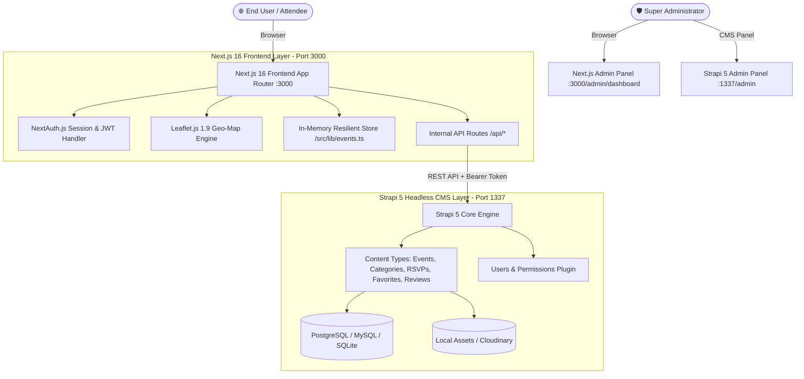
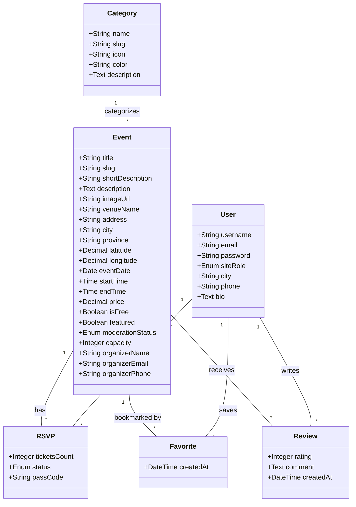
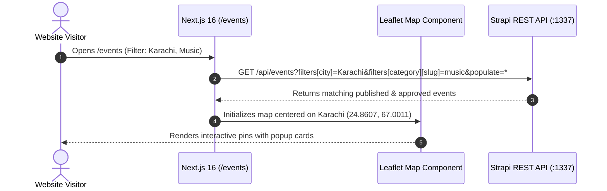
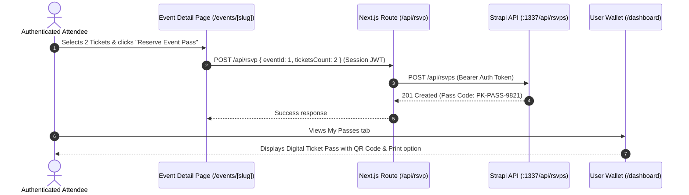

# EventDiscovery Pakistan 🇵🇰 — Complete System Walkthrough & Strapi 5 Guide

Welcome to the **EventDiscovery Pakistan** platform documentation. This document provides an exhaustive, end-to-end technical walkthrough of the entire platform, explaining the architecture, how the **Strapi 5 Headless CMS** works, how the **Next.js 16 App Router Frontend** interacts with it, and step-by-step instructions for running, managing, and testing all workflows.

---

## 📑 Table of Contents
1. [🏛️ High-Level System Architecture](#1-high-level-system-architecture)
2. [📦 Strapi 5 CMS Architecture & Data Schemas](#2-strapi-5-cms-architecture--data-schemas)
3. [⚙️ Strapi 5 Setup, Configuration & Bootstrapping](#3-strapi-5-setup-configuration--bootstrapping)
4. [🖥️ How to Use Strapi CMS (Complete Admin Guide)](#4-how-to-use-strapi-cms-complete-admin-guide)
5. [🔄 End-to-End Data & Integration Flow](#5-end-to-end-data--integration-flow)
6. [🎯 Frontend User & Administrator Workflows](#6-frontend-user--administrator-workflows)
7. [🔐 Test Credentials & Demo Accounts](#7-test-credentials--demo-accounts)
8. [🧪 Step-by-Step Functional Verification Scenarios](#8-step-by-step-functional-verification-scenarios)
9. [🌐 Zero-Friction Dual-Mode Fallback Architecture](#9-zero-friction-dual-mode-fallback-architecture)
10. [🔧 Troubleshooting & Developer Tips](#10-troubleshooting--developer-tips)

---

## 🏛️ 1. High-Level System Architecture

The platform is designed following a modern decoupled architecture:



### Component Roles
- **Next.js 16 Frontend (`frontend/`)**: Renders high-performance server components, responsive Bootstrap & Tailwind UI, Leaflet.js interactive maps, client-side modals, QR code tickets, and handles NextAuth authentication.
- **Strapi 5 CMS (`cms/`)**: Provides headless content management, automated relational database schemas, REST APIs, role-based access control (RBAC), draft/publish lifecycle, and media asset library.
- **Resilient Fallback Store (`frontend/src/lib/events.ts`)**: Ensures the frontend remains 100% testable and operable with rich mock Pakistani data even when Strapi is offline or being migrated.

---

## 📦 2. Strapi 5 CMS Architecture & Data Schemas

Strapi 5 manages 5 custom Content Types in addition to the built-in Users & Permissions plugin:



### Content Types Specification

| Content Type | Singular Name | Key Fields & Types | Purpose & Lifecycle |
| :--- | :--- | :--- | :--- |
| **Event** | `api::event.event` | `title` (String), `slug` (UID), `shortDescription` (String), `description` (RichText/Text), `imageUrl` (String), `venueName` (String), `address` (String), `city` (String), `province` (String), `latitude` (Float), `longitude` (Float), `eventDate` (Date), `startTime` (Time), `endTime` (Time), `price` (Decimal), `isFree` (Boolean), `featured` (Boolean), `moderationStatus` (`pending` \| `approved` \| `rejected`), `capacity` (Integer), `organizerName` (String) | Stores all Pakistani community events, tech summits, Sufi concerts, and marathons. Uses Draft/Publish + Moderation workflow. |
| **Category** | `api::category.category` | `name` (String), `slug` (UID), `icon` (String: FontAwesome), `color` (String: Hex), `description` (Text) | Represents the 7 Pakistani event domains (*Technology, Music, Sports, Art & Culture, Food & Drink, Community, Health & Wellness*). |
| **RSVP** | `api::rsvp.rsvp` | `ticketsCount` (Integer), `status` (`confirmed` \| `cancelled`), `event` (Relation), `user` (Relation) | Stores confirmed digital event passes. Powers the user's QR Ticket Wallet in `/dashboard`. |
| **Favorite** | `api::favorite.favorite` | `event` (Relation), `user` (Relation) | Stores saved/bookmarked events for quick access. |
| **Review** | `api::review.review` | `rating` (Integer: 1-5), `comment` (Text), `event` (Relation), `user` (Relation) | Stores attendee ratings and community testimonials. |
| **User** | `plugin::users-permissions.user` | `username` (String), `email` (Email), `password` (Password), `siteRole` (`user` \| `admin`), `city` (String), `phone` (String), `bio` (Text) | Authenticated user accounts with role-based dashboard access. |

---

## ⚙️ 3. Strapi 5 Setup, Configuration & Bootstrapping

### Step 1: Environment Configuration (`cms/.env`)
Create or edit `cms/.env` with the following configuration:

```ini
# Server Settings
HOST=0.0.0.0
PORT=1337

# Application Security Keys (32-character random strings)
APP_KEYS="3A8x9Q2mY8kR4wT7zL1vB5nP0qS6uX9e,8kR4wT7zL1vB5nP0qS6uX9e3A8x9Q2mY"
API_TOKEN_SALT="e3A8x9Q2mY8kR4wT7zL1vB5nP0qS6uX9"
ADMIN_JWT_SECRET="T7zL1vB5nP0qS6uX9e3A8x9Q2mY8kR4w"
TRANSFER_TOKEN_SALT="L1vB5nP0qS6uX9e3A8x9Q2mY8kR4wT7z"
JWT_SECRET="9e3A8x9Q2mY8kR4wT7zL1vB5nP0qS6uX"

# Database Configuration (PostgreSQL example)
DATABASE_CLIENT=postgres
DATABASE_HOST=127.0.0.1
DATABASE_PORT=5432
DATABASE_NAME=event_discovery
DATABASE_USERNAME=postgres
DATABASE_PASSWORD=postgres
DATABASE_SSL=false
```

> **Using SQLite instead?** If you prefer zero-install SQLite, set:
> ```ini
> DATABASE_CLIENT=sqlite
> DATABASE_FILENAME=.tmp/data.db
> ```

### Step 2: Start Strapi CMS Development Server
From the root workspace directory, run:

```powershell
npm run dev:cms
```

Or from the `cms/` directory:
```powershell
cd cms
npm run develop
```

### Step 3: Automatic Bootstrap & Data Seeding
Upon startup, `cms/src/index.ts` automatically executes the `bootstrap()` lifecycle hook:
1. **7 Categories Created**: Automatically populates *Technology*, *Music*, *Sports*, *Art & Culture*, *Food & Drink*, *Community*, and *Health & Wellness* with exact branding colors and FontAwesome icons.
2. **8 Flagship Pakistani Events Seeded**: Automatically creates records for *Pakistan Tech Summit & AI Conclave*, *Lahore Sufi Night*, *Karachi Coastal Marathon*, *Karachi Eat*, *Lok Virsa Heritage Expo*, etc., complete with coordinates and high-res media.
3. **Automated RBAC Permissions**: Automatically grants `Public` role permissions for viewing events/categories/reviews, and `Authenticated` role permissions for RSVPs, favorites, reviews, and event proposals.

---

## 🖥️ 4. How to Use Strapi CMS (Complete Admin Guide)

### Initial Administrator Setup
1. When running Strapi for the first time, open **[http://localhost:1337/admin](http://localhost:1337/admin)** in your browser.
2. Complete the initial Super Admin form:
   - **First Name**: Admin
   - **Last Name**: Pakistan
   - **Email**: `admin@eventdiscovery.pk`
   - **Password**: `pakistan2026`
3. Click **Let's Start** to access the Strapi Admin Panel.

---

### Managing Content in Strapi

```
┌─────────────────────────────────────────────────────────────┐
│  STRAPI 5 ADMIN PANEL                                       │
├─────────────────────────────────────────────────────────────┤
│  📁 CONTENT MANAGER                                         │
│     ├── 📅 Events           (Create, Edit, Publish, Feature)│
│     ├── 🏷️ Categories       (Manage Categories, Icons)     │
│     ├── 🎟️ RSVPs            (Inspect Confirmed Bookings)    │
│     ├── ⭐ Favorites        (Inspect Saved Events)          │
│     ├── 💬 Reviews          (Moderate User Reviews)         │
│     └── 👤 Users            (Manage Roles & Profiles)       │
│                                                             │
│  ⚙️ SETTINGS                                                │
│     ├── 🔑 API Tokens       (Generate tokens for Next.js)   │
│     └── 👥 Roles & Permissions (Configure Public/Auth API)  │
└─────────────────────────────────────────────────────────────┘
```

#### A. Creating & Moderating Events in Strapi
1. Navigate to **Content Manager** ➔ **Event**.
2. Click **Create new entry** (top right).
3. Fill in the event details:
   - **Title**: *e.g., Islamabad Food & Qawwali Gala 2026*
   - **Slug**: *e.g., islamabad-food-qawwali-gala*
   - **Category**: Select *Food Street & Chai Fests* or *Music & Qawwali Nights*.
   - **City**: *Islamabad*, **Venue**: *F-9 Park Amphitheater*.
   - **Latitude**: `33.7077`, **Longitude**: `73.0188`.
   - **Event Date**: `2026-12-28`, **Start Time**: `18:00:00`.
   - **Price**: `1500`, **Capacity**: `500`.
   - **Featured**: Check toggle if you want it spotlighted on the Next.js home hero.
   - **Moderation Status**:
     - `pending`: Event is under review by moderators.
     - `approved`: Event is verified and will display on public maps.
     - `rejected`: Event violated guidelines and is hidden.
4. Click **Save** then **Publish**.

#### B. Managing Community Submissions
When a regular user proposes an event from the frontend (`/submit-event`):
1. The submission enters Strapi with `moderationStatus = "pending"` in draft state.
2. The Administrator opens Strapi ➔ **Content Manager** ➔ **Event**.
3. Filters by `moderationStatus: pending`.
4. Inspects the details, changes `moderationStatus` to `"approved"`, and clicks **Publish**.
5. The event instantly appears on the Next.js live Leaflet map and event catalog!

#### C. Promoting Users to Administrators
1. Go to **Content Manager** ➔ **User**.
2. Click on the user record (e.g. `admin@eventdiscovery.pk`).
3. Set `siteRole` to `admin`.
4. Click **Save**. The user now has full access to the Next.js Super Admin Dashboard at `/admin/dashboard`.

---

## 🔄 5. End-to-End Data & Integration Flow

### 1. Public Event Discovery Flow


### 2. Event Pass Reservation (RSVP) Flow


---

## 🎯 6. Frontend User & Administrator Workflows

| Page / Route | Role | Description & Available Actions |
| :--- | :--- | :--- |
| **`/`** (Home) | Public | Hero search bar (City & Category filters), Interactive Live Pakistani Geo-Map, Featured Events carousel, Top City hubs, Newsletter subscription. |
| **`/events`** | Public | Split Map & List Explorer with synchronized Leaflet hover highlights, Grid view toggle, keyword search, price & category filters, 1-click RSVP. |
| **`/events/[slug]`** | Public / Auth | High-res hero gallery, Google Maps directions button, Leaflet venue pin, 1-5 Star community reviews submission, sticky pass reservation widget, host details. |
| **`/categories`** | Public | 7 Curated category cards with live event count badges and visual color accents. |
| **`/dashboard`** | Authenticated | **User Management Center**: Overview stats, My Passes (RSVP Digital Wallet with QR Code modal & printable pass), Bookmarked Favorites, Submission History, Profile Settings. |
| **`/submit-event`** | Authenticated | 5-Section Event Proposal Form with automatic Pakistani city coordinate calculation, live image preview, ticket pricing, and host contact fields. |
| **`/admin/dashboard`** | Super Admin | **Admin Control Center**: KPI Analytics (Total Events, Pending Approvals, Total RSVPs, Estimated Revenue PKR), Tab 1: Live Event Approval/Rejection workflow, Tab 2: Master Directory with Featured toggles & Delete, Tab 3: Registered User directory. |
| **`/login` & `/register`** | Guest | Fast authentication with 1-click demo credential filling buttons for Admin and Attendee accounts. |

---

## 🔐 7. Test Credentials & Demo Accounts

The system includes pre-configured credentials for testing all roles:

| Account Type | Email Address | Password | Role & Permissions |
| :--- | :--- | :--- | :--- |
| 🛡️ **Super Administrator** | `admin@eventdiscovery.pk` | `pakistan2026` | Full administrative control: `/admin/dashboard`, Event Approvals, Rejections, Toggle Featured, Delete events, View users. |
| 👤 **Verified Attendee** | `ahmed.khan@eventdiscovery.pk` | `pakistan2026` | Attendee capabilities: `/dashboard`, Digital QR Passes Wallet, Ticket Printing, RSVP Booking, Bookmarks, Reviews, Event Proposals. |
| 🆕 **Custom Registration** | Any email via `/register` | Custom password | Full attendee access with custom Pakistani city and contact details. |

---

## 🧪 8. Step-by-Step Functional Verification Scenarios

### Scenario 1: Search & Filter on the Interactive Geo-Map
1. Open **[http://localhost:3000](http://localhost:3000)**.
2. In the hero search bar, select **City** = `Karachi` and **Category** = `Food Street & Chai Fests`.
3. Click **Search Events**. The page navigates to `/events` with active filters.
4. Switch to **"Map & List View"** in the top right.
5. Hover over any event card on the left — the Leaflet map smoothly pans to the venue marker.
6. Click the map pin to view the event preview popup card.

### Scenario 2: Reserve an Event Pass & Generate QR Ticket
1. Navigate to `/events/pakistan-tech-summit-ai-conclave-2026`.
2. In the sticky right sidebar, adjust tickets to `2` and click **"Reserve Event Pass 🇵🇰"**.
3. If not signed in, you will be prompted to login. Use `ahmed.khan@eventdiscovery.pk` / `pakistan2026`.
4. After reservation, go to **[http://localhost:3000/dashboard](http://localhost:3000/dashboard)**.
5. In the **"My Passes (RSVP Wallet)"** tab, click **"Show QR Pass"**.
6. The modal renders the official **Digital Admission Pass** with QR Code, Barcode, and **Print Pass** button.

### Scenario 3: Submit a Community Event Proposal
1. Click **"Submit Event"** in the top navigation bar or go to `/submit-event`.
2. Enter details:
   - **Title**: *Lahore Indie Game Developers Showcase*
   - **Category**: *Technology & Hackathons*
   - **City**: *Lahore* (Notice latitude/longitude auto-populate)
   - **Venue**: *Arfa Software Technology Park*
   - **Date**: *2026-12-20*, **Time**: *14:00 to 19:00*
   - **Price**: *0 (Free Admission)*
3. Click **"Submit Event for Approval 🇵🇰"**.
4. The proposal is saved into the moderation queue with `status: pending`.

### Scenario 4: Review & Approve the Event as Super Admin
1. Sign out and sign in as **Super Admin** (`admin@eventdiscovery.pk` / `pakistan2026`).
2. Click **"Admin Portal"** in the navigation bar or go to `/admin/dashboard`.
3. Under the **"Event Approval Workflow"** tab, find the newly submitted proposal.
4. Click **"Approve"** (instantly transitions the event to `approved` and publishes it).
5. Switch to **"All Events Management"** tab to toggle the event as **Featured** or search master listings.
6. Check `/events` — the newly approved event is now visible to all visitors!

---

## 🌐 9. Zero-Friction Dual-Mode Fallback Architecture

The frontend is engineered with resilient dual-mode operation:

```
                  ┌────────────────────────────────────────┐
                  │ Next.js 16 App Router (/src/lib/events)│
                  └───────────────────┬────────────────────┘
                                      │
                 Does STRAPI_URL respond successfully?
                                 /         \
                              YES           NO
                              /               \
            ┌──────────────────────┐    ┌───────────────────────────┐
            │ Connect to Strapi 5  │    │ Fallback to In-Memory     │
            │ REST API (:1337)     │    │ Mock Data Store           │
            └──────────────────────┘    └───────────────────────────┘
```

- **Online Mode (`STRAPI_URL` active)**: Fetches and persists live data to Strapi 5 and PostgreSQL/MySQL.
- **Standalone Mode (`STRAPI_URL` inactive / offline)**: Seamlessly uses the built-in in-memory store in `frontend/src/lib/events.ts`. All 7 workflows (Approvals, RSVPs, Bookmarks, QR Passes, Reviews) operate seamlessly without crashing.

---

## 🔧 10. Troubleshooting & Developer Tips

### Port 3000 Conflict
If port 3000 is occupied by another process:
```powershell
# Kill existing process on port 3000
npx kill-port 3000

# Or start Next.js on port 3001
npm run dev -- -p 3001
```

### Windows SWC Compiler Cache Lock
If Strapi reports an SWC binary lock on Windows:
```powershell
$env:SWC_NATIVE_BINDING_CACHE = 'C:\swc-native-build-cache'
npm run dev:cms
```

### Production Build Verification
To test full static type checking and production route bundling:
```powershell
npm run build
```
*(All 22 App Router routes compile with 0 TypeScript/ESLint errors).*

---

🇵🇰 **EventDiscovery Pakistan** — Built with Next.js 16, React 19, Leaflet.js, and Strapi 5 Headless CMS.
